# WaysHub Deployment - DevOps Assignment

## Overview

Deployment WaysHub menggunakan 2 server:

| Server | Hostname | Private IP | Service |
|---|---|---|---|
| Gateway | gateway | 172.31.41.102 | Nginx, WaysHub Frontend, WaysHub Backend, PM2 |
| Database | db | 172.31.3.65 | MySQL |


## 1. Server Preparation
Deployment menggunakan dua server, yaitu:
- Gateway untuk Frontend, Backend, dan Web Server.
- Database untuk MySQL.
Hostname server:
```
gateway
db
```
Gateway menggunakan private IP:
```
172.31.41.102
```
Database menggunakan private IP:
```
172.31.3.65
```

## 2. User & SSH Key
User reza dibuat dan digunakan untuk login ke server.
Login ke Gateway dilakukan menggunakan SSH key melalui alias:
```
gateway
```
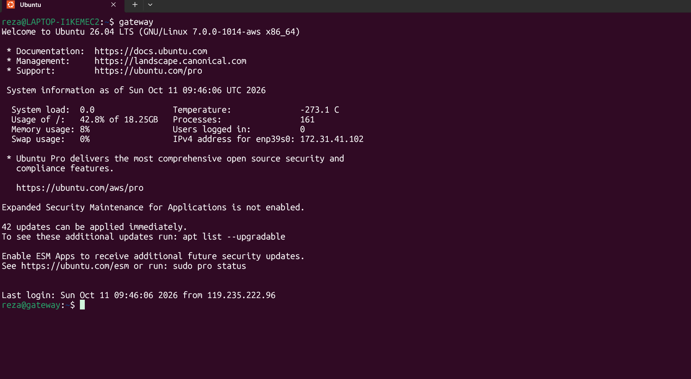

Login berhasil menggunakan SSH key dan masuk sebagai:
``
reza@gateway
``
Verifikasi User dan SSH Key
```
id reza
ls -la ~/.ssh/
```
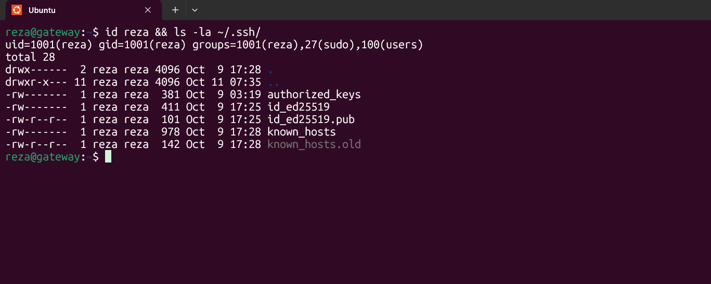

Directory .ssh berisi authorized_keys yang digunakan untuk autentikasi SSH.

## 3. MySQL
MySQL di-install pada server Database.
Status service MySQL:
```
sudo systemctl status mysql --no-pager
```

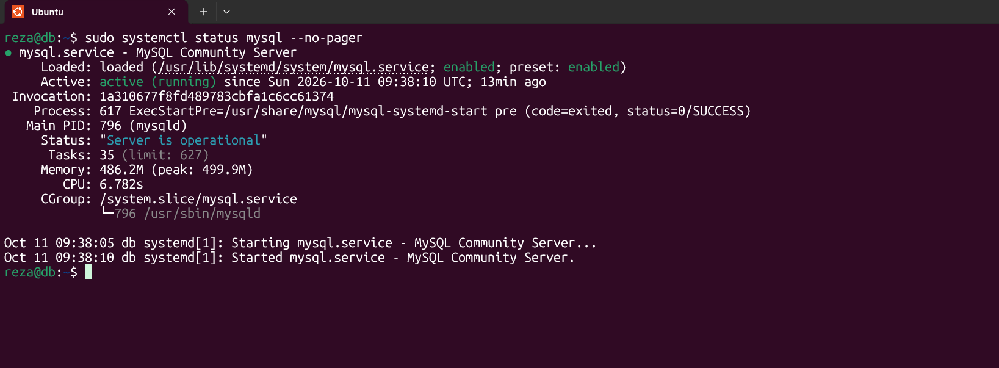

MySQL berhasil berjalan dengan status:
Active: active (running)

## 4. Database & Transaction
Database yang digunakan adalah:
``
demo
``
Database kemudian digunakan untuk membuat tabel transaction.
Perintah yang digunakan:
```
SHOW DATABASES;

USE demo;

SHOW TABLES;

DESCRIBE transaction;
```
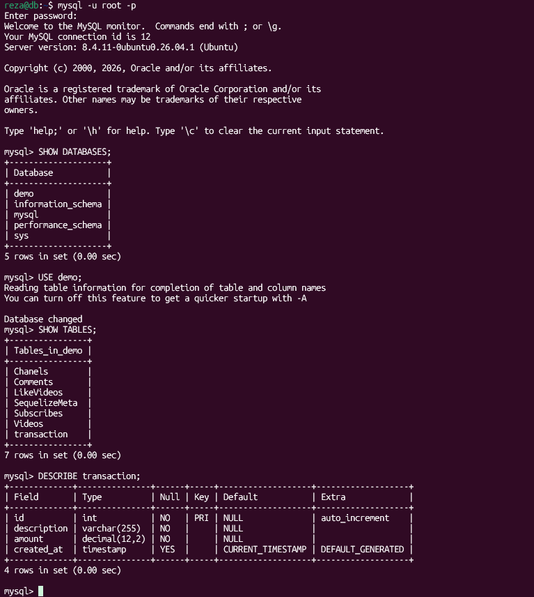

Struktur tabel transaction:

| Column | Type |
|---|---|
| id | INT |
| description | VARCHAR(255) |
| amount | DECIMAL(12,2) |
| created_at | TIMESTAMP |

Dummy Data
Data transaction dibuat untuk pengujian:
```
SELECT * FROM transaction;
```
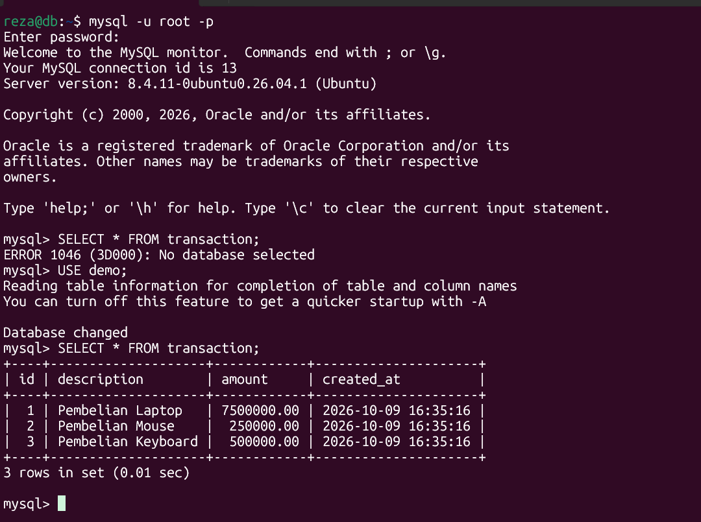

Data yang tersedia:
- Pembelian Laptop
- Pembelian Mouse
- Pembelian Keyboard

## 5. Role Based Access Control
Dibuat dua role MySQL:
``
admin
guest
``
Permission yang diberikan:
```
Admin
```
Admin memiliki hak:
```
SELECT
INSERT
UPDATE
DELETE
```
pada:
```
demo.transaction
```
Guest
Guest hanya memiliki hak:
``
SELECT
``
pada:
```
demo.transaction
```
Verifikasi privilege:
```
SHOW GRANTS FOR 'admin';
SHOW GRANTS FOR 'guest';
```

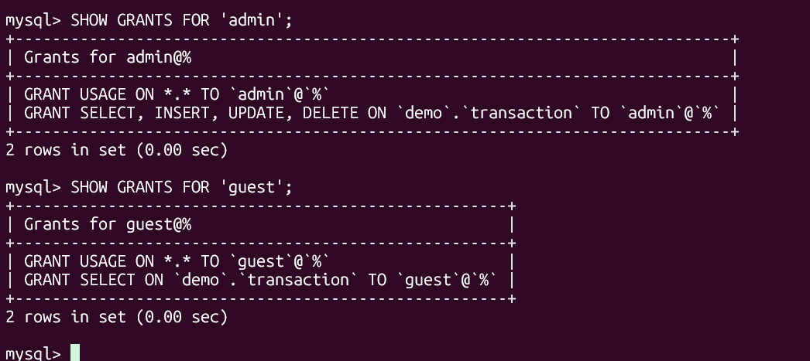

User `reza` diberikan role `admin`, sedangkan user `guest` diberikan role guest

### Testing Guest
Login remote sebagai user guest dari Gateway:
```
mysql -h 172.31.3.65 -u guest -p demo
```
Guest dapat melakukan:
```
SELECT * FROM transaction;
```
Tetapi tidak dapat melakukan:
```
INSERT INTO transaction (description, amount)
VALUES ('Test Guest', 1000);
```
Hasil:
```
ERROR 1142: INSERT command denied
```
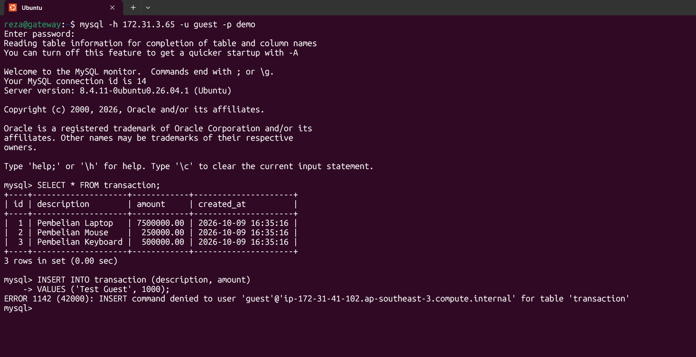

Hal ini membuktikan bahwa role `guest` hanya memiliki permission `SELECT`.

### Testing Admin
User `reza` digunakan untuk menguji role admin.
```
mysql -h 172.31.3.65 -u reza -p demo
```
Testing permission:
```
SELECT * FROM transaction;

INSERT INTO transaction (description, amount)
VALUES ('Test Admin', 1000);

UPDATE transaction
SET amount = 2000
WHERE description = 'Test Admin';

DELETE FROM transaction
WHERE description = 'Test Admin';
```
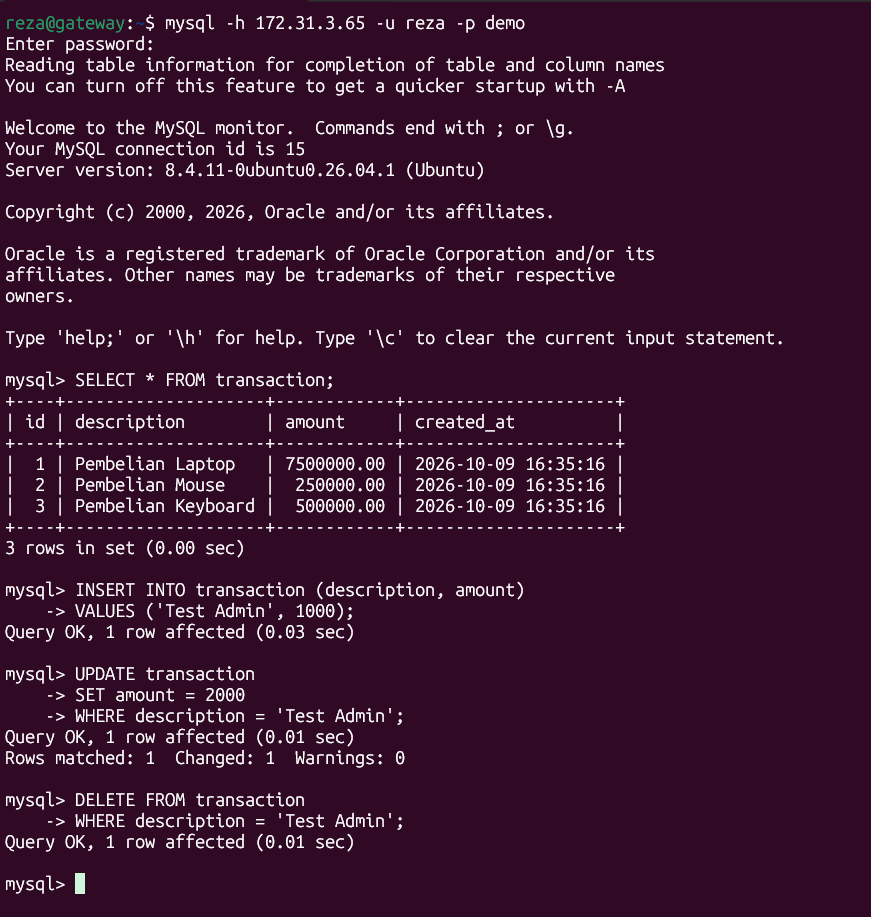

Semua operasi berhasil sehingga role `admin` memiliki permission:
```
SELECT
INSERT
UPDATE
DELETE
```

## 6. Remote Database Access
Database dikonfigurasi agar dapat diakses melalui private IP server Database.
Remote connection dilakukan dari Gateway:
```
mysql -h 172.31.3.65 -u reza -p -e "SELECT @@hostname, CURRENT_USER();"
```
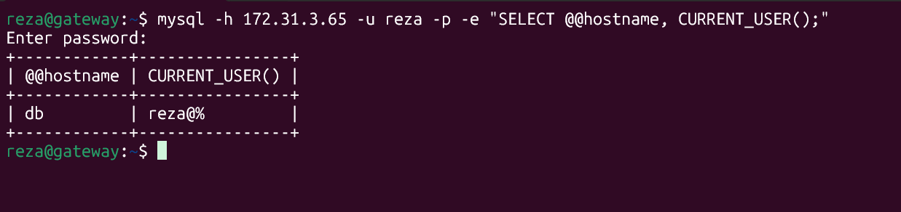


Hasil menunjukkan:
```
hostname      : db
current user  : reza@%
```
Hal ini membuktikan Gateway berhasil melakukan koneksi ke MySQL pada server Database.

## 7. WaysHub Backend
WaysHub Backend dijalankan pada Gateway menggunakan Node.js dan PM2.
PM2 digunakan untuk menjalankan aplikasi secara persistent.
Verifikasi process:
```
pm2 status
```

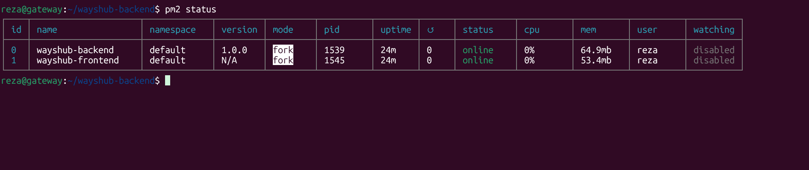

Process yang berjalan:
```
wayshub-backend   online
wayshub-frontend  online
```
Backend berjalan pada:
```
127.0.0.1:5000
```

## 8. WaysHub Frontend
WaysHub Frontend dijalankan pada Gateway dan dikelola menggunakan PM2.
Frontend berjalan pada:
```
127.0.0.1:3000
```
Frontend kemudian diakses melalui domain:
```
reza.studentdumbways.my.id
```

## 9. Nginx Reverse Proxy
Nginx digunakan sebagai reverse proxy untuk Frontend dan Backend.
Konfigurasi dibuat secara terpisah untuk mengurangi risiko kesalahan konfigurasi.
File konfigurasi:
```
/etc/nginx/sites-available/wayshub-frontend
/etc/nginx/sites-available/wayshub-backend
```
Kedua konfigurasi diaktifkan melalui:
```
/etc/nginx/sites-enabled/
```
Verifikasi:
```
ls -l /etc/nginx/sites-enabled/
```
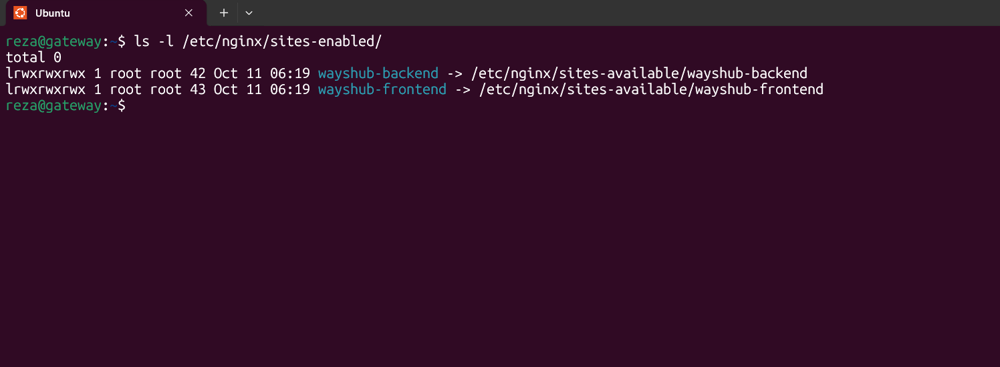


Konfigurasi Nginx menggunakan dua virtual host:
```
reza.studentdumbways.my.id
api.reza.studentdumbways.my.id
```
Validasi Nginx
```
sudo nginx -t
```
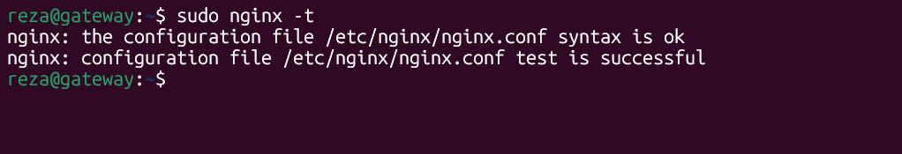

Hasil:
```
syntax is ok
test is successful
```

## 10. Testing
Backend API
API Backend diuji menggunakan:
```
curl -i http://127.0.0.1:5000/api/v1/videos/0/8
```

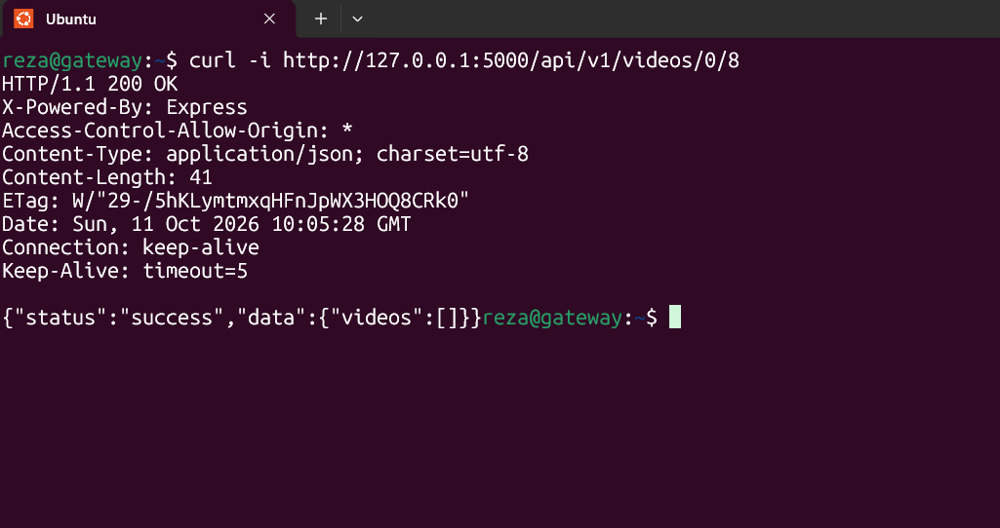

API memberikan response:
```
HTTP/1.1 200 OK
```
dengan response:
```
{
  "status": "success",
  "data": {
    "videos": []
  }
}
```
Data video kosong karena belum terdapat video yang di-upload. Endpoint API tetap berhasil memberikan response 200 OK.

### Login WaysHub
Aplikasi diakses melalui:
```
reza.studentdumbways.my.id
```
Login berhasil dan user dapat masuk ke halaman Home.

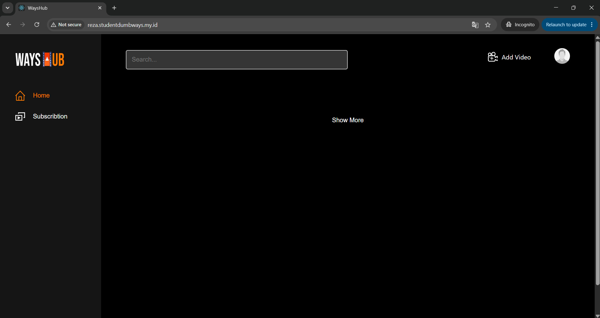

