# WaysHub with Docker and CI/CD

## 1. Gambaran arsitektur

Implementasi saat ini menggunakan **3 VM**, sesuai batas arsitektur yang dipilih:

| VM | Peran | Komponen |
|---|---|---|
| Gateway | Reverse proxy dan CI server | Nginx Docker, Jenkins native, sertifikat Let's Encrypt wildcard |
| Application | Menjalankan aplikasi | Frontend dan backend di Docker Compose |
| Database | Database terpisah | MySQL 8.4 di Docker Compose dengan persistent volume |

## 2. User dan instalasi Docker

User Linux yang digunakan adalah `reza`. Docker Engine dan Docker Compose terpasang pada VM terkait. Script instalasi Docker tersedia di Gateway pada `/home/reza/install-docker.sh`. Script instalasi juga dibuat di VM Application pada `/home/ubuntu/wayshub/scripts/install-docker.sh` dan telah diperiksa sintaks Bash-nya; script Application tersebut tidak dijalankan ulang karena Docker sudah terpasang.

Versi yang terlihat pada Gateway saat dokumentasi diambil:

- Docker Engine: `29.9.1`
- Docker Compose: `v5.6.0`

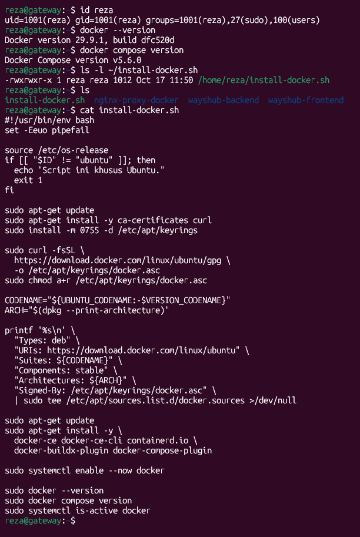

## 3. Database MySQL dalam Docker

Database dijalankan pada VM Database menggunakan image `mysql:8.4` di container `wayshub-mysql`. Data database disimpan pada named volume `wayshub_mysql_data`, yang dipasang ke `/var/lib/mysql`. File SQL initialization dan konfigurasi MySQL low-memory juga dipasang ke container.

Tabel yang diverifikasi pada `wayshub_db`:

- `Chanels`
- `Comments`
- `LikeVideos`
- `SequelizeMeta`
- `Subscribes`
- `Videos`

Pemeriksaan terakhir menunjukkan satu record pada tabel `Chanels`.

- 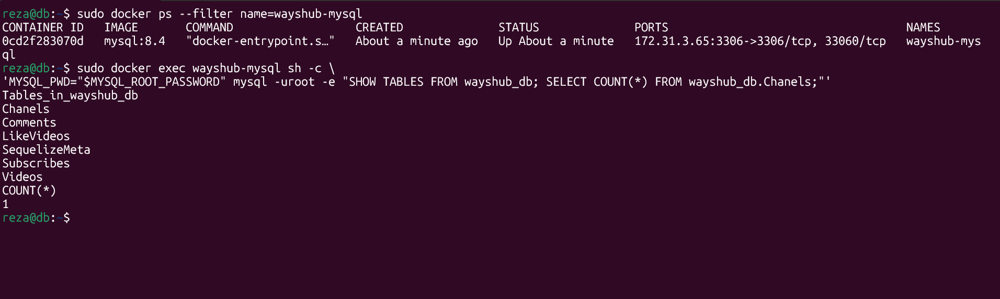
- 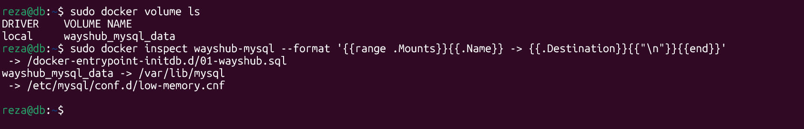

### Catatan troubleshooting database

Setelah VM reboot, container MySQL sempat tidak dapat start karena service MySQL native pada host lebih dulu memakai port `172.31.3.65:3306`. Service native tersebut kemudian dihentikan dan dinonaktifkan, lalu container `wayshub-mysql` berhasil dijalankan kembali menggunakan volume lama. Setelah pemulihan, tabel dan data diverifikasi, dan tes API kembali memberi HTTP 200. Volume `wayshub_mysql_data` tidak dihapus.

## 4. Frontend dan backend dengan Docker Compose

Compose aplikasi berada di `/home/ubuntu/wayshub/compose.yaml` pada VM Application. Service yang berjalan:

| Service | Image | Port/container |
|---|---|---|
| `frontend` | `reza1019/wayshub-frontend:latest` | Host port `3000` menuju container port `3000` |
| `backend` | `reza1019/wayshub-backend:latest` | Port internal `5000` |

Kedua service terhubung ke custom bridge network bernama `reza_network`. Backend menggunakan environment file `.env`; frontend bergantung pada service backend.

### Multistage build

- Frontend menggunakan `node:16-alpine` sebagai tahap builder dan `nginx:alpine` untuk menyajikan hasil build.
- Backend menggunakan tahap builder dan runtime berbasis `node:18-alpine`, lalu menjalankan aplikasi dengan `pm2-runtime`.

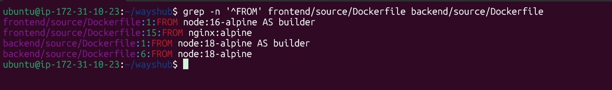

## 5. Nginx reverse proxy dalam Docker

Reverse proxy berada pada VM Gateway dalam container `wayshub-nginx-proxy` menggunakan image `nginx:alpine`, dengan port publik 80 dan 443. Konfigurasi Nginx dipasang dari `/home/reza/nginx-proxy-docker/conf.d` ke `/etc/nginx/conf.d` dalam mode read-only. Sertifikat dipasang dari `/etc/letsencrypt` ke container dalam mode read-only.

Domain yang diarahkan melalui Gateway:

| Layanan | Domain |
|---|---|
| Frontend | `https://reza.studentdumbways.my.id` |
| API | `https://api.reza.studentdumbways.my.id` |
| Jenkins | `https://jenkins.reza.studentdumbways.my.id` |

Uji `nginx -t` berhasil. Mount konfigurasi dan sertifikat diverifikasi melalui `docker inspect`.

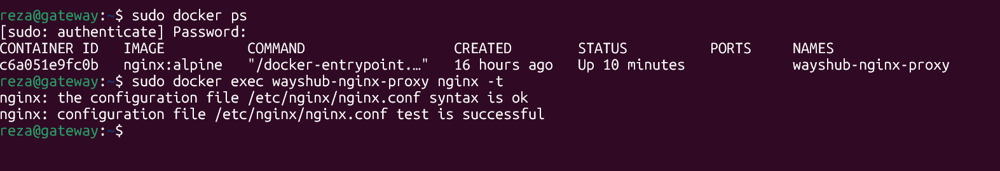
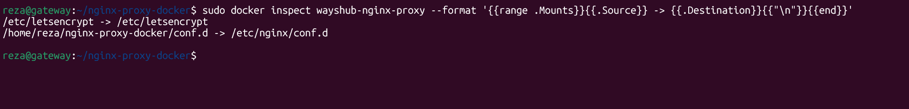

## 6. SSL wildcard dan Cloudflare

Sertifikat wildcard Let's Encrypt digunakan untuk domain utama dan subdomain `*.reza.studentdumbways.my.id`. Masa berlaku sertifikat yang terlihat saat pemeriksaan berakhir pada 15 Januari 2027.

Cloudflare DNS disetel ke **DNS only** untuk domain frontend, API, dan Jenkins, sehingga proxy Cloudflare tidak aktif sesuai instruksi tugas.

Hook deploy Certbot telah dibuat untuk menguji konfigurasi Nginx dan melakukan reload container setelah renewal. Pemanggilan hook berhasil. `certbot renew --cert-name reza-wildcard --dry-run` juga berhasil menyimulasikan renewal.

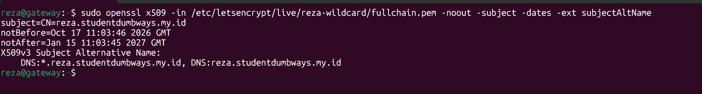
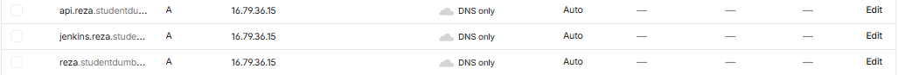

## 7. CI/CD frontend dengan Jenkins

Jenkins di-install secara native pada VM Gateway dan diakses lewat domain reverse proxy. Credential IDs yang diverifikasi pada Jenkins:

- `wayshub-ssh-key` — SSH deployment ke Application
- `dockerhub-creds` — akses Docker Hub
- `DISCORD_WEBHOOK_URL` — notifikasi Discord

Pipeline `wayshub-frontend-deploy` terakhir yang didokumentasikan berstatus sukses. Tahap yang tampak pada Jenkins:

1. Checkout SCM
2. Pull from GitHub
3. Build Docker Image
4. Test Application
5. Push to Docker Hub
6. Deploy Application
7. Post Actions (notifikasi Discord)

Bukti:
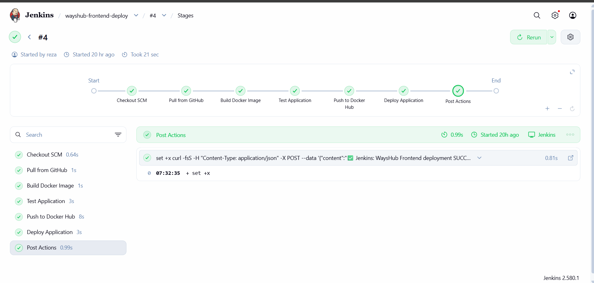
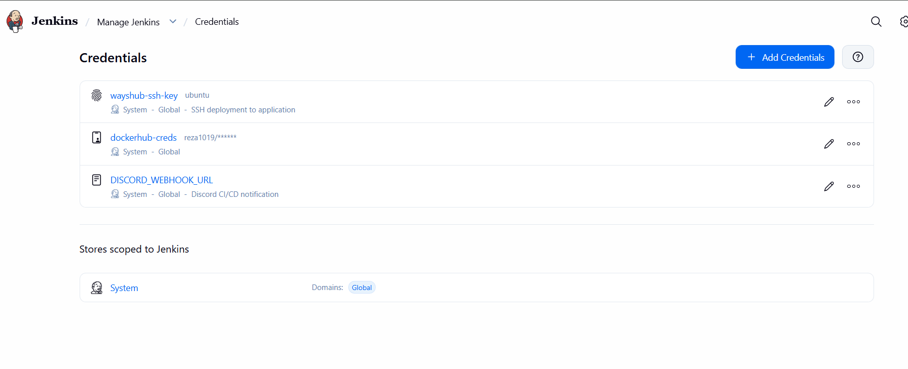

## 8. CI/CD backend dengan GitHub Actions

Sesuai pilihan implementasi, pipeline backend berjalan lewat GitHub Actions, bukan Jenkins. Workflow `WaysHub Backend CI/CD` pada repository `Reza152/wayshub-backend` ditampilkan dengan status **Success**. Workflow menangani proses build/test, push image, dan deployment backend serta mengirim status ke Discord.

Tangkapan layar run yang disertakan menunjukkan eksekusi manual (`workflow_dispatch`) berhasil. Screenshot tersebut juga menampilkan warning terkait Node.js pada action; warning itu tidak menggagalkan run yang berhasil.

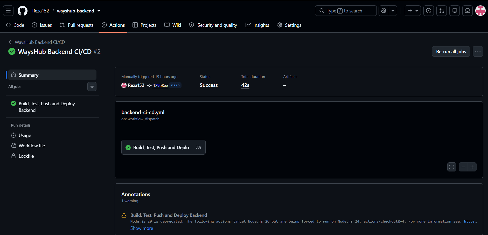

> **Catatan kesesuaian rubrik:** teks tugas menyebutkan pembuatan Jenkins jobs untuk frontend dan backend. Pada implementasi ini, Jenkins digunakan untuk frontend dan GitHub Actions digunakan untuk backend, sesuai desain pipeline yang dipilih.

## 9. Docker Hub dan notifikasi Discord

Image aplikasi dipush ke Docker Hub:

- `reza1019/wayshub-frontend:latest`
- `reza1019/wayshub-backend:latest`

Notifikasi Discord menampilkan status sukses dari pipeline frontend Jenkins dan pipeline backend GitHub Actions. Tangkapan layar notifikasi juga berisi satu kegagalan backend yang lebih awal dan notifikasi sukses setelah perbaikan; bukti tidak menyembunyikan urutan tersebut.

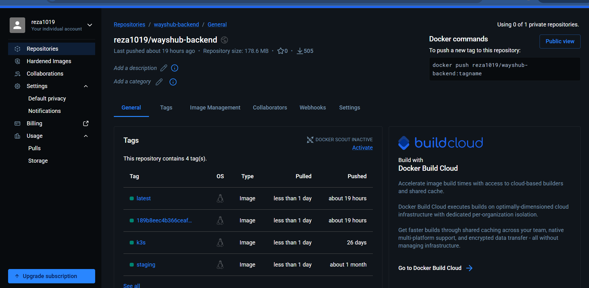
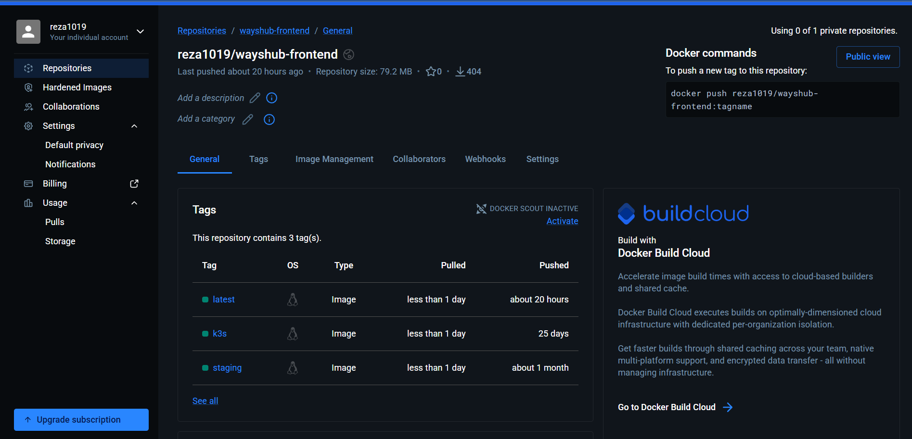
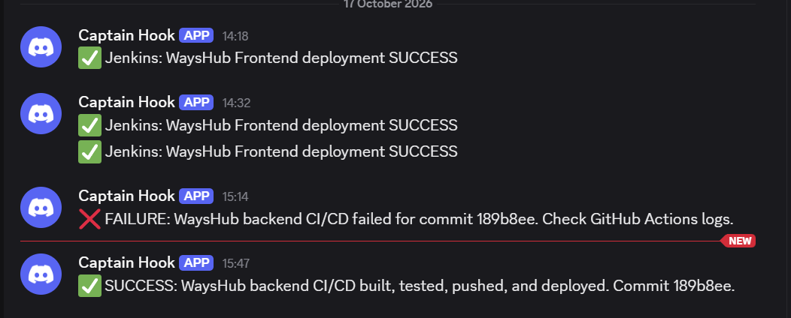

## 10. Pengujian aplikasi dan endpoint

Pengujian terakhir dari Gateway menghasilkan:

| Pengujian | Hasil |
|---|---|
| Frontend HTTPS | HTTP 200 |
| API `GET /api/v1/videos/0/8` melalui HTTPS | HTTP 200 |
| Jenkins `/login` melalui HTTPS (tes sebelumnya) | HTTP 200 |
| Nginx config test | Successful |
| Certbot renewal dry-run wildcard | Successful |

Pengguna juga telah menguji login, register, dan fitur aplikasi setelah login secara manual serta melaporkan tidak ada error. Screenshot browser untuk login/register tidak disertakan sesuai keputusan dokumentasi; bukti terminal untuk tes domain dan endpoint disertakan.

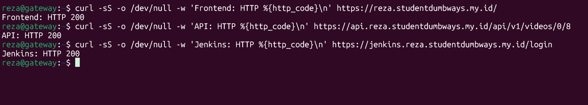

